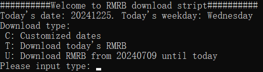
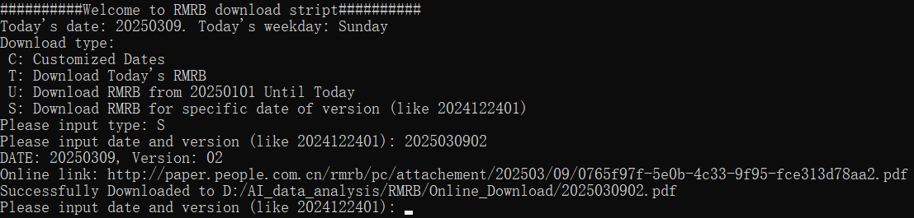
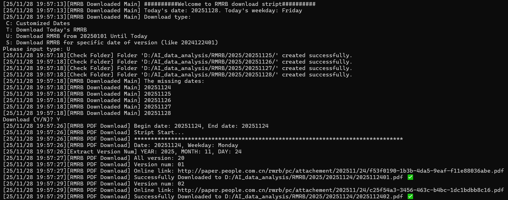

**English** | [简体中文](README.zh-CN.md)

# RMRB Analysis

## Overview

Analyze People’s Daily (人民日报, RMRB) advertisements by detecting ad pages, extracting ad blocks, running OCR, and generating LLM-based industry classification and commentary.

## Workflow

Get original RMRB PDF
→ Detect advertisements by computer vision/text rules
→ Generate advertisement images (full/half/CV)
→ Extract ad blocks and filter duplicates
→ Convert images to text using OCR
→ Use AI to classify industry + ad type + region + analysis

## Setup

1. Install dependencies:
   - `pip install -r requirements.txt`
2. Configure data paths in `Config/Config.py`:
   - `MAIN_PATH` / `EXTERNAL_PATH` / `EXTERNAL_PATH_LIST`
   - `MODEL_PATH` for PaddleOCR models
3. Download PaddleOCR model folders into `MODEL_PATH` (see PaddleOCR model list/releases):
   - https://github.com/PaddlePaddle/PaddleOCR/blob/main/doc/doc_en/models_list_en.md
   - https://github.com/PaddlePaddle/PaddleOCR/releases
   - Extract the archives so the listed folders are direct children of `MODEL_PATH`.
   - `PP-DocLayout_plus-L_infer/`
   - `PP-OCRv5_server_det_infer/`
   - `PP-OCRv5_server_rec_infer/`
   - `PP-Chart2Table_infer/`
4. Create `Config/API.py` (gitignored) with your LLM providers and keys:
   - Required by `RMRBCore/RMRB_LLM_v5.py` (`MODEL` dict with URL/Models/Keys)
   - Example:
     ```python
     MODEL = {
       "GEMINI": {
         "URL": "",  # Not used for GEMINI; required for most other APIs
         "Models": ["gemini-2.5-flash"],
         "Keys": ["<api-key>"]
       }
     }
     ```

## Data Layout

The analysis pipeline reads/writes under the data root (from `Config/Config.py`).

```
{DATA_ROOT}/
  {YEAR}/
    {YYYYMMDD}/
      {YYYYMMDD}.pdf or {YYYYMMDD}{VV}.pdf
  {YEAR}_AD/
    {YYYYMMDD}/
      {YYYYMMDD}_{VV}_FAD.png          # full-page ad
      {YYYYMMDD}_{VV}_HAD.png          # half-page ad
      {YYYYMMDD}_{VV}_CV.png           # CV-detected page
      {YYYYMMDD}_{VV}_{TYPE}_Block_{i}.png
      {image}.json                     # OCR + LLM outputs
    {YEAR}_Shape_Dict*.json            # shape filters & dedupe lists
```

## Run Analysis (CLI)

Windows users can use the `.bat` scripts in `Scripts/` (or `PortableScripts/`).

1. **Prepare PDFs (optional tools)**
   - `python RMRB_PDFTools.py`
   - Includes: MAC checker, folder formatter, existence check, PDF splitter, name fixer.
2. **Generate ad images / blocks**
   - `python RMRB_AD_Image_Generator.py`
   - Options:
     - Generate AD Image (FAD/HAD/CV)
     - Extract AD Block (creates `*_Block_*.png`)
     - AD Shape Analysis + Duplicate Check (writes final filter lists)
3. **OCR**
   - `python RMRB_OCR.py`
   - Writes OCR content into per-image JSON files.
4. **LLM summary & classification**
   - `python RMRB_LLM.py`
   - Generates `Summary~...` fields in the same JSON files.
5. **Notebooks**
   - `RMRB_Analysis_v5.ipynb`
   - `RMRBCore/AD-Quant-Analysis.ipynb`, `AD_Text_Analysis.ipynb`, etc.

> ETF, index list data source: Wencai from Tonghuashun (Question -> Share Link -> Data link -> Web scraper)
# RMRB Strategy

A research framework that asks one question of the advertisement archive: **does
what the People's Daily prints tell you anything tradable about Chinese
equities?**

The short answer, established below, is *a little, but not enough*. There is a
statistically detectable contrarian signal in state-media attention, and it does
not survive transaction costs. The framework is built to establish that kind of
verdict honestly rather than to produce a flattering equity curve — most of the
code below exists to catch the ways a backtest lies.

## Modules

All under `RMRBCore/`, plain `.py`, importable independently.

| Module | Role |
| --- | --- |
| `RMRB_Dataset_v6.py` | Raw ad JSON tree → daily industry panels. Filename parsing across both archive conventions, duplicate-creative screening, multi-model soft voting, page-area and prominence weighting, SW level-1 / level-2 tiers, CSV caching. |
| `RMRB_Factor_v6.py` | Share of Voice, seasonal detrending, trailing z-scores, activity masking, winsorising, cross-sectional standardisation, momentum/volatility controls, orthogonalisation, factor blending. |
| `RMRB_Backtest_v6.py` | Daily weight-drift portfolio engine with explicit execution lag, two-sided costs, turnover caps, overlapping tranches; APY / Sharpe / Sortino / Calmar / MDD / IR / alpha / beta / Newey-West t-stats. |
| `RMRB_Research_v6.py` | Rank IC, horizon scan, quantile ladder, event study, lead-lag, IS/OOS split, parameter grid, permutation test, deflated Sharpe, block bootstrap. |
| `RMRB_Strategy_v6.py` | Strategy registry — each entry states its economic hypothesis. Retains the original `Daily_Z_Score_SoV`. |
| `RMRB_Pipeline_v6.py` | CLI that runs the whole study and writes tables to `Output/`. |

```bash
python RMRBCore/RMRB_Pipeline_v6.py --rebuild --figures
```

`--level 2` switches the cross-section to SW level-2 sub-industries, `--stage`
runs a single stage. The data root is found via `RMRB_DATA_ROOT`, then
`RMRBData/`, then the drive list in `Config/Config.py`; the archive itself is
gitignored.

## What the framework adds to the notebooks

`AD-Quant-Analysis.ipynb` and `Industry-Analysis.ipynb` both begin from
`AD_Industry_Count_Analysis.csv`, which reduces each ad to a hard count of its
top-2 modal industries, commercial ads only. Four things get recovered here:

- **Ad size and page position.** A full page is not a half-page block, and page 2
  is not page 16. Both are read from the archive (`Shape_Dict` pixel areas) and
  used as spend and prominence weights.
- **Model disagreement.** Each ad carries ~15 independent LLM classifications.
  Soft-voting keeps the confidence information a modal label throws away; mean
  agreement is 72% at level 1 and 58% at level 2.
- **The policy channel.** Public-service and policy ads were previously dropped.
  They are a different economic signal from a corporate media buy and get their
  own panel.
- **Coverage.** The legacy CSV totals 7,983 industry-counts; reproducing its own
  hard-count rule over the reconstructed 10,598 retained ads gives 10,466. The
  gap is mostly ads on the same page overwriting each other under a
  date-plus-page key.

Extraction: 10,598 ads (6,931 full-page, 1,436 half-page blocks, 2,231
CV-detected blocks), 143 dropped as duplicate creatives, 3,507 publication days
from 2014-01 to 2025-12. Every retained ad maps to a valid Shenwan industry.

## Method

Counts → Share of Voice → seasonal detrend → 12-month trailing z-score within
each industry → activity mask → winsorise → cross-sectional rank.

Three of those steps are corrections to specific failure modes:

1. **Within-industry z-scoring** fixes the structural bias that sank the
   notebook's strategy. Banking is covered every month and cosmetics almost
   never, so a raw cross-sectional sort re-selects the same permanently-quiet
   sectors forever and becomes an accidental small-cap beta bet. Comparing each
   sector to its own history removes it.
2. **Seasonal detrending** is not cosmetic; see the trap below.
3. **The activity mask** drops sectors averaging under 0.5 ads/month over the
   trailing year, where a z-score just reflects whether one ad happened to run.
   About 24 of 31 sectors survive.

Backtests execute a month-end signal on the *second* trading day of the
following month, let weights drift with returns between rebalances, and charge
15 bp one-way on both legs.

## Findings

**1. The contrarian signal is real but small.** Attention today predicts weaker
returns next month.

| Panel | Rank IC | ICIR | t (Newey-West) |
| --- | --- | --- | --- |
| All ads | −0.0372 | −0.187 | −2.16 |
| Prominence-weighted commercial | −0.0335 | −0.141 | −1.81 |
| Commercial only | −0.0268 | −0.116 | −1.49 |
| Area-weighted commercial | −0.0306 | −0.126 | −1.59 |
| Public-service only | −0.0142 | −0.050 | −0.51 |
| Legacy hard count | −0.0185 | −0.090 | −1.14 |

132 monthly cross-sections, ~24 industries each. The reconstructed panel roughly
doubles the legacy count's t-statistic. Shuffling the score cross-section within
each month gives p = 0.03, so the ranking is not an artefact of the score
distribution. All 18 cells of the parameter grid carry the hypothesised sign.

**2. The alpha window is one to three months.** Contrarian IC by horizon: +0.037
(t = 2.16) at one month, +0.039 (t = 2.55) at two, +0.034 at three, zero by six,
and negative by ten. Coverage marks a local top that unwinds over a quarter and
then reverts.

**3. The payoff is in avoidance, not selection.** Quintile portfolios, % per
month: Q1 (loudest) 0.314, Q2 0.459, Q3 0.653, Q4 0.635, Q5 (quietest) 0.659.
The ladder is monotone (Spearman ρ = +0.90) but flat above Q3 — essentially all
of the effect is the most-covered quintile underperforming. Owning the quietest
sectors is not the trade; not owning the loudest ones is.

**4. It does not survive transaction costs.** The Q5−Q1 spread is 0.35%/month
gross. A dollar-neutral book captures half of that and needs 3.2× annual
turnover even with 3-month tranches:

| One-way cost | 0 bp | 5 bp | 10 bp | 15 bp | 20 bp | 30 bp |
| --- | --- | --- | --- | --- | --- | --- |
| Net APY | +0.99% | +0.67% | +0.34% | +0.02% | −0.30% | −0.94% |

Break-even is around 15 bp, which is roughly the real cost of trading A-share
sector ETFs. No long-only variant beats the equal-weight sector basket by a
significant margin either: over the aligned 2015-01 to 2025-12 window the
benchmark returns 4.01% APY, the best attention strategy (`silent_winner`,
neglect blended with 1-month momentum) 4.74%, with an information ratio of 0.14
and t = 0.61. That is noise.

**5. The macro timing signal is a seasonality trap.** This is the most useful
negative result. Aggregate commercial ad area, z-scored on a 36-month window,
correlates −0.27 (t = −3.0) with next-month equal-weight sector returns, and an
exposure overlay built on it returns 10.82% APY against the basket's 4.00% —
+6.82% excess at t = 2.75. It is an illusion. RMRB ad volume is violently
seasonal (December and March run four to five times February, one-way ANOVA
p ≈ 1e-28)
and A-share returns have their own calendar (January −3.3%, February +3.2%).
Under a month-of-year control the correlation falls to −0.11 (t = −1.2) and the
overlay's excess drops to 2.82% at t = 1.53. The apparent alpha was two
calendars agreeing. `macro_timing_exposure(deseason=True)` is the default for
this reason.

**6. Breadth expansion fails.** The Fundamental Law says IR scales with the
square root of breadth, so moving from 31 sectors to 123 SW level-2
sub-industries should help. It does the opposite: at ~74 ads/month total, per-name
flow becomes too thin, IC collapses to −0.011 (t = −0.79), the quintile ladder
loses monotonicity (ρ = +0.30), and the sign flips between the in-sample and
out-of-sample windows. Signal degradation outruns the breadth gain.

**7. The signal is mostly independent of price momentum**, and slightly stronger:
neglect IC +0.037 (t = 2.16), neglect orthogonalised to 1-month momentum +0.028
(t = 1.56), momentum alone +0.023 (t = 0.92). The information is not a repackaged
price factor — it is just not large enough to pay for its own turnover.

**Out-of-sample.** The split at 2021-01-01 was fixed before any strategy was
sized. Contrarian IC is +0.043 (t = 2.11) in-sample and +0.031 (t = 1.02)
out-of-sample: the same sign and a similar magnitude, with significance that
does not survive the shorter window.

## Verdict

State-media attention in the People's Daily is a genuine, measurable, contrarian
sector signal with a one-to-three month horizon, concentrated in the
underperformance of the most-covered sectors. Its effect size — roughly 0.35% per
month on a top-versus-bottom quintile spread — is below the cost of harvesting
it at any rebalancing frequency the signal decays fast enough to require.

It is usable as a **risk overlay** rather than an alpha source: `hype_avoidance`
excludes recently-spiked sectors from an equal-weight basket at 0.9× annual
turnover and tracks the benchmark within 0.13% APY, so the tilt is nearly free
if you want the exposure reduction. Deploying it as a standalone strategy is not
supported by this evidence, and the deflated Sharpe confirms the point: against
108 configurations tried, the observed Sharpe sits below what random search would
be expected to produce.

Two caveats worth stating. The backtest trades Shenwan sector *indices*, which
overstates achievable returns for sectors without a liquid ETF. And 132 monthly
cross-sections is a short sample for a t-statistic of 2.2 — the finding is
suggestive, not settled.

# RMRB Online Downloader

CMD interface (RMRB_Online_v1):



(RMRB_Online_v1.1):



(RMRB_Downloader_v2) (Old name `RMRB_Online`)


